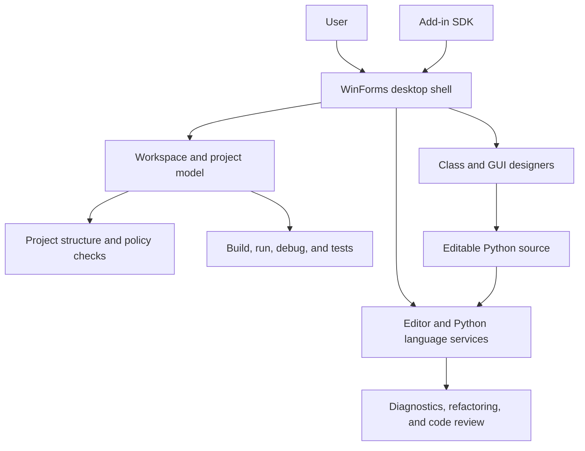

# Architecture

HelixPython is a Windows desktop IDE for Python. Its visual tools create and inspect projects,
while Python source and project metadata stay editable as ordinary files.

## Desktop shell

The WinForms application hosts the editor, Solution Explorer, designers, output panels, and
commands. It coordinates workspace services and sends user actions to the same services used by
the rest of the application.

## Workspace model

The workspace reads Python project metadata and maps projects, packages, and source files. It
checks that the model agrees with the directory tree before it allows solution actions to run.
See [workspace rules](workspace-rules.md) for the checks.

## Language and analysis services

Python language services provide parsing, completion, diagnostics, semantic analysis, and
refactoring. Analysis tools use those services to review source, calculate metrics, and find
potential issues.

## Editing and designers

The editor works with Python source directly. Visual designers write Python source and project
metadata that users can inspect and edit in the editor.

## Execution and integrations

The IDE uses a local Python installation to run projects. Optional tools provide debugging,
testing, notebook execution, CMake builds, and native C or C++ workflows. Availability depends on
the tools installed on the user's computer.

## Add-ins

The add-in SDK exposes extension points for menus, tabs, file types, and Solution Explorer
commands. The built-in GUI Designer uses the same extension model. See [add-ins](addins/README.md).
